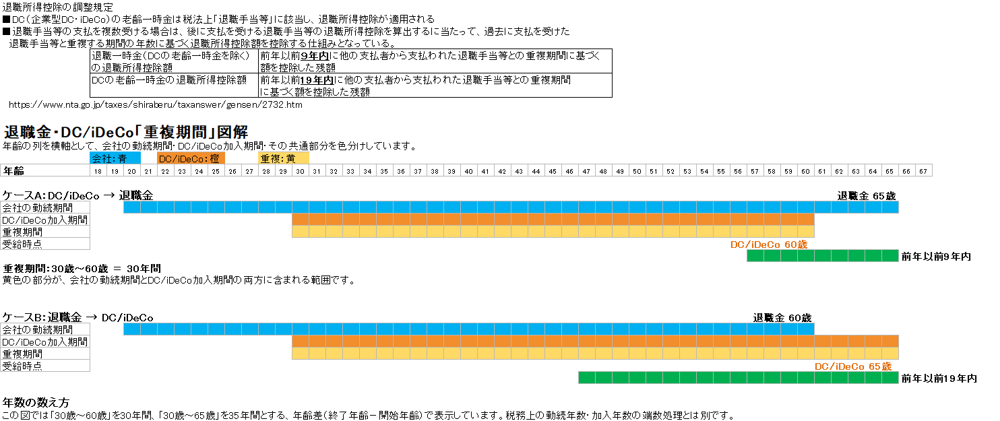

# 通常の退職金＋確定拠出年金：重複調整シミュレーション

通常の退職金と、確定拠出年金（企業型DC・iDeCo）の一時金を受け取る場合について、**受取時期による退職所得控除の重複調整**をシミュレーションするExcelです。

退職金と確定拠出年金を別々の時期に一時金として受け取る場合、受取順序や受取時期によって、退職所得控除の計算に重複調整が必要となることがあります。

本Excelでは、退職金と確定拠出年金の受取時期などを入力し、重複調整後の退職所得控除額などを比較できるようにしています。

---

## このExcelでできること

主に次のようなケースを想定しています。

- 会社から退職金を一時金で受け取る
- 企業型DCを一時金で受け取る
- iDeCo（個人型確定拠出年金）を一時金で受け取る
- 退職金と確定拠出年金を異なる時期に受け取る
- 退職金と確定拠出年金の受取順序を変更して比較する
- 受取時期による退職所得控除の重複調整の違いを確認する
- 複数の受取時期を設定してシミュレーションする

---

## 企業型DCとiDeCoについて

本Excelでは、作成時の入力項目や説明の多くで「企業型DC」という表記を使用しています。

ただし、国税庁の「退職手当等に対する源泉徴収」では、企業型年金規約または個人型年金規約に基づく老齢給付金の一時金も、退職所得として取り扱われます。

そのため、本Excelでは確定拠出年金の一時金を受け取る場合の重複調整を対象としており、iDeCoの一時金を受け取る場合にも利用できるようにしています。

> ※本Excelでは「企業型DC」と記載している箇所がありますが、iDeCo（個人型確定拠出年金）の一時金についても、該当する税法上の規定に基づく重複調整の対象となります。
>
> 企業型DCを利用していない方は、「企業型DC」を「iDeCo」と読み替えてご利用ください。

---

## 退職金とDC・iDeCoの重複調整

退職所得は、原則として次の式で計算します。

```
退職所得 ＝（収入金額 − 退職所得控除額）× 1/2
```

退職所得控除額は、原則として勤続年数に応じて次のように計算します。

- 勤続年数20年以下：40万円 × 勤続年数（最低80万円）
- 勤続年数20年超：800万円 ＋ 70万円 ×（勤続年数 − 20年）

ただし、過去に退職手当等を受け取っている場合や、退職金と確定拠出年金の一時金を異なる時期に受け取る場合などには、退職所得控除額の計算において、勤続期間・加入期間などの重複部分を調整することがあります。

このため、退職金とDC・iDeCoの受取時期を検討する際には、単に受取間隔だけを見るのではなく、**どちらを先に受け取るか、各制度の対象期間がどの程度重複しているか**を確認することが重要です。

### 重複期間の考え方（図解）

以下の図は、退職金とDC・iDeCoの一時金を受け取る順序によって、重複調整の対象となる期間がどのように変わるかを整理したものです。



#### ケースA：DC・iDeCoを先に受け取り、その後に退職金を受け取る

先に受け取った確定拠出年金の一時金について、後から受け取る退職金の退職所得控除額を計算する際に、過去の退職手当等との重複期間が調整対象となる場合があります。

#### ケースB：退職金を先に受け取り、その後にDC・iDeCoを受け取る

先に退職金を受け取り、その後に確定拠出年金の一時金を受け取る場合にも、受取時期や対象期間などの条件に応じて、退職所得控除額の重複調整が必要となる場合があります。

#### 9年・19年の調整期間について

確定拠出年金の老齢給付金を一時金で受け取る場合、退職手当等との受取順序や受取年に応じて、前年以前9年内または19年内などの期間を考慮する規定があります。

また、退職金とDC・iDeCoの一時金だけでなく、DB（確定給付企業年金）など、ほかの退職手当等が関係する場合にも注意が必要です。

**9年・19年という期間は、単純に受取間隔を空ければ必ず重複調整を回避できる、という意味ではありません。** 実際の適用関係は、受取年、受取順序、各制度の対象期間、過去の退職手当等の有無などによって異なります。

詳しくは、国税庁「No.2732 退職手当等に対する源泉徴収」を確認してください。

https://www.nta.go.jp/taxes/shiraberu/taxanswer/gensen/2732.htm

なお、本Excelは、これらの条件を入力して受取時期による違いを比較するためのシミュレーションツールです。すべての税務上の適用関係を網羅するものではありません。

---

## Excelの基本的な使い方

### 1. 「入力」シート

会社の退職金および確定拠出年金について、必要な情報を入力します。

主な入力項目は次のとおりです。

- 会社退職金の勤続開始日
- 会社退職金の退職日
- 会社退職金の受取日
- 会社退職金額
- 確定拠出年金の控除計算用加入開始日
- 確定拠出年金の控除計算用加入終了日
- 確定拠出年金の一時金受取日
- 確定拠出年金の一時金額
- その他、重複調整に必要な情報

※実際の入力項目はExcelのバージョンによって異なる場合があります。

### 2. 重複調整の計算

入力した退職金・確定拠出年金の情報をもとに、次の項目などを計算します。

- 退職所得控除額
- 重複期間
- 重複調整後の退職所得控除額
- 受取順序による違い

### 3. 受取時期の比較

確定拠出年金の受取時期などを変更し、次のようなケースを比較できます。

```
退職金 → 確定拠出年金
```

```
確定拠出年金 → 退職金
```

受取時期を変更しながら、退職所得控除の重複調整がどのように変わるかを確認できます。

---

## 本Excelで対応していないもの

現在のExcelでは、すべての退職所得に関する税務上のケースを網羅しているわけではありません。

### 同じ年に複数種類の退職手当等を受け取るケース

国税庁のNo.2741に記載されている、次の2種類以上を同じ年に受け取るケースについては、現在のExcelでは対応していません。

- 一般退職手当等
- 短期退職手当等
- 特定役員退職手当等

> **未対応**
>
> このケースでは、通常の退職所得の計算とは異なる計算方法が必要となる場合があります。

詳しくは、国税庁「No.2741 同じ年に一般退職手当等のほか、短期退職手当等や特定役員退職手当等がある場合」を確認してください。

https://www.nta.go.jp/taxes/shiraberu/taxanswer/gensen/2741.htm

---

## 注意事項

このExcelは、退職金・確定拠出年金の受取時期を検討する際の**シミュレーション・参考資料**として作成したものです。

実際の退職所得控除額や税額は、個々の勤務状況、加入期間、過去の退職金の受取状況、退職金制度・年金制度の内容、税制改正などによって異なる場合があります。

特に、次のようなケースでは個別の確認が必要です。

- 過去に退職金等を受け取っている
- 複数の退職金制度がある
- DB（確定給付企業年金）がある
- iDeCoと企業型DCの両方がある
- 同一年に複数の退職手当等を受け取る
- 役員退職金がある
- 短期間の勤務に対応する退職金がある

本Excelの計算結果は、税務上の判断を保証するものではありません。

重要な税務上の判断については、国税庁、税務署、税理士等の専門家に確認してください。

---

## 参考資料

### 国税庁：No.1420 退職金を受け取ったとき（退職所得）

退職所得の概要、退職所得控除額、退職所得の計算方法などについて説明されています。

https://www.nta.go.jp/taxes/shiraberu/taxanswer/shotoku/1420.htm

### 国税庁：No.2732 退職手当等に対する源泉徴収

退職所得控除額の計算、過去の退職手当等との重複期間、確定拠出年金の一時金に関する9年・19年の調整などについて説明されています。

https://www.nta.go.jp/taxes/shiraberu/taxanswer/gensen/2732.htm

### 国税庁：No.2741 同じ年に一般退職手当等のほか、短期退職手当等や特定役員退職手当等がある場合

同一年に複数種類の退職手当等がある場合の計算方法について説明されています。

https://www.nta.go.jp/taxes/shiraberu/taxanswer/gensen/2741.htm

※本Excelでは、No.2741に記載されているケースには対応していません。

---

## 対象となる主な制度

| 制度 | 一時金で受け取る場合 |
| --- | --- |
| 会社の退職金 | 対象 |
| 企業型DC | 対象 |
| iDeCo（個人型DC） | 対象 |
| DB（確定給付企業年金） | 個別の制度内容によるため注意 |
| 短期退職手当等 | 一部の複数区分の計算ケースは未対応 |
| 特定役員退職手当等 | 一部の複数区分の計算ケースは未対応 |

---

## Excelファイル

[GitHub：最新版Excelはこちら](https://github.com/pukkunk/retirement-income-tax-dc-excel/blob/main/%E9%80%80%E8%81%B7%E9%87%91_%E7%A2%BA%E5%AE%9A%E6%8B%A0%E5%87%BA%E5%B9%B4%E9%87%91_%E9%87%8D%E8%A4%87%E8%AA%BF%E6%95%B4%E3%82%B7%E3%83%9F%E3%83%A5%E3%83%AC%E3%83%BC%E3%82%B7%E3%83%A7%E3%83%B3.xlsx)

---

## 免責事項

本Excelは、退職金および確定拠出年金の一時金を受け取る場合の退職所得控除等について、受取時期による違いを確認するための個人作成のシミュレーションツールです。

税務申告や退職金・年金の受取方法を決定する際には、必ず最新の法令・国税庁の情報等を確認してください
