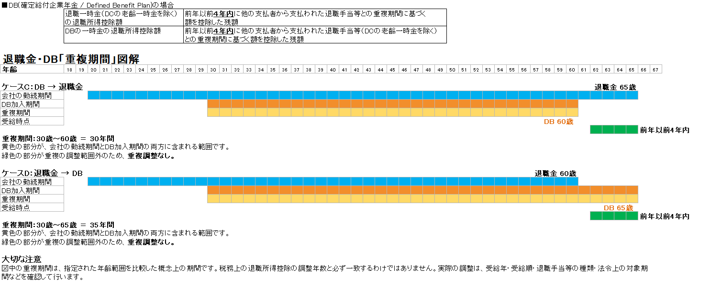

# 通常の退職金＋確定拠出年金・確定給付企業年金：重複調整シミュレーション

通常の退職金と、確定拠出年金（企業型DC・iDeCo）または確定給付企業年金（DB）の一時金を受け取る場合について、**受取時期による退職所得控除の重複調整**をシミュレーションするExcelです。

退職金と企業年金を別々の時期に一時金として受け取る場合、受取順序や受取時期によって、退職所得控除の計算に重複調整が必要となることがあります。

本Excelでは、退職金と企業年金の種類、受取時期などを入力し、重複調整後の退職所得控除額などを比較できるようにしています。

また、DB・DCの選択に応じて、重複調整の計算条件を切り替える機能に対応しました。

---

## このExcelでできること

主に次のようなケースを想定しています。

- 会社から退職金を一時金で受け取る
- 企業型DCを一時金で受け取る
- iDeCo（個人型確定拠出年金）を一時金で受け取る
- DB（確定給付企業年金）を一時金で受け取る
- 退職金と企業年金を異なる時期に受け取る
- 退職金と企業年金の受取順序を変更して比較する
- 受取時期による退職所得控除の重複調整の違いを確認する
- DB・DCを選択し、重複調整の計算条件を切り替える
- 複数の受取時期を設定してシミュレーションする

---

## 今回の更新内容

今回のExcelの修正では、主に次の内容を変更しました。

### 1. Excelの計算式を修正

入力内容に応じて、制度の種類や受取順序を判定し、該当する重複調整の計算条件を反映するよう修正しました。

### 2. DB（確定給付企業年金）に対応

従来の確定拠出年金（DC）に加え、DB（確定給付企業年金）を考慮したシミュレーションに対応しました。

### 3. DB・DCの選択による重複調整期間の切り替え

対象となる制度を選択し、制度に応じて重複調整の計算条件を切り替えられるようにしました。

- **DC（確定拠出年金）：9年・19年**
- **DB（確定給付企業年金）：4年・4年**

これにより、選択した制度に応じた計算条件で、受取時期による違いを比較できます。

※上記はExcelに実装した切り替え条件です。実際の税務上の適用期間や計算方法は、受取年、受取順序、対象期間、過去の退職手当等の受取状況などによって異なります。

---

## 企業型DC・iDeCo・DBについて

本Excelでは、会社の退職金と企業年金の一時金を受け取る場合の退職所得控除の重複調整を検討します。

- **DC（確定拠出年金）**：企業型DCおよびiDeCo（個人型確定拠出年金）
- **DB（確定給付企業年金）**：規約などに基づく確定給付型の企業年金
- **会社退職金**：会社から支給される退職手当等

各制度では、税務上の取扱いや対象となる期間が異なる場合があります。実際に受け取る年金制度に合わせて、Excelの選択項目を設定してください。

---

## 退職金とDC・iDeCo・DBの重複調整

退職所得は、原則として次の式で計算します。

```
退職所得 ＝（収入金額 − 退職所得控除額）× 1/2
```

退職所得控除額は、原則として勤続年数に応じて次のように計算します。

- 勤続年数20年以下：40万円 × 勤続年数（最低80万円）
- 勤続年数20年超：800万円 ＋ 70万円 ×（勤続年数 − 20年）

ただし、過去に退職手当等を受け取っている場合や、退職金と企業年金の一時金を異なる時期に受け取る場合などには、退職所得控除額の計算において、勤続期間・加入期間などの重複部分を調整することがあります。

このため、退職金とDC・iDeCo・DBの受取時期を検討する際には、単に受取間隔だけを見るのではなく、**どの制度を先に受け取るか、各制度の対象期間がどの程度重複しているか**を確認することが重要です。

### 重複期間の考え方（図解）

以下の図は、退職金と企業年金の一時金を受け取る順序によって、重複調整の対象となる期間がどのように変わるかを整理したものです。

#### DC（確定拠出年金）の場合


#### DB（確定給付企業年金）の場合



#### 9年・19年および4年・4年の計算条件について

本Excelでは、DB・DCの選択に応じて、重複調整の計算条件を切り替えます。

| 選択する制度 | Excelの計算条件 |
| --- | --- |
| DC（確定拠出年金） | 9年・19年 |
| DB（確定給付企業年金） | 4年・4年 |

これらはExcelに実装した切り替え条件です。実際の税務上の適用関係は、受取順序、受取年、対象期間、過去の退職手当等の有無などによって異なります。

**一定の年数だけ受取間隔を空ければ、必ず重複調整を回避できるという意味ではありません。**

詳しくは、国税庁「No.2732 退職手当等に対する源泉徴収」を確認してください。

https://www.nta.go.jp/taxes/shiraberu/taxanswer/gensen/2732.htm

なお、本Excelは、受取時期による違いを比較するためのシミュレーションツールです。すべての税務上の適用関係を網羅するものではありません。

---

## Excelの基本的な使い方

### 1. 「入力」シート

会社の退職金および企業年金について、必要な情報を入力します。

主な入力項目は次のとおりです。

- 会社退職金の勤続開始日
- 会社退職金の退職日
- 会社退職金の受取日
- 会社退職金額
- 企業年金の種類（DB・DC）
- 企業年金の控除計算用加入開始日
- 企業年金の控除計算用加入終了日
- 企業年金の一時金受取日
- 企業年金の一時金額
- その他、重複調整に必要な情報

※実際の入力項目はExcelのバージョンによって異なる場合があります。

### 2. DB・DCの選択

入力シートで、対象となる企業年金の種類を選択します。

- DCを選択した場合：9年・19年の計算条件
- DBを選択した場合：4年・4年の計算条件

選択した制度に応じて、重複調整に使用する計算条件が切り替わります。

### 3. 重複調整の計算

入力した退職金・企業年金の情報をもとに、次の項目などを計算します。

- 退職所得控除額
- 重複期間
- 重複調整後の退職所得控除額
- DB・DCの選択に応じた計算条件
- 受取順序による違い

### 4. 受取時期の比較

企業年金の受取時期などを変更し、次のようなケースを比較できます。

```
退職金 → 企業年金
```

```
企業年金 → 退職金
```

受取時期や制度の選択を変更しながら、退職所得控除の重複調整がどのように変わるかを確認できます。

---

## 本Excelで対応していないもの

現在のExcelでは、すべての退職所得に関する税務上のケースを網羅しているわけではありません。

### 同じ年に複数種類の退職手当等を受け取るケース

国税庁のNo.2741に記載されている、次の2種類以上を同じ年に受け取るケースについては、現在のExcelでは対応していません。

- 一般退職手当等
- 短期退職手当等
- 特定役員退職手当等

> **未対応**
>
> このケースでは、通常の退職所得の計算とは異なる計算方法が必要となる場合があります。

詳しくは、国税庁「No.2741 同じ年に一般退職手当等のほか、短期退職手当等や特定役員退職手当等がある場合」を確認してください。

https://www.nta.go.jp/taxes/shiraberu/taxanswer/gensen/2741.htm

---

## 注意事項

このExcelは、退職金・企業年金の受取時期を検討する際の**シミュレーション・参考資料**として作成したものです。

実際の退職所得控除額や税額は、個々の勤務状況、加入期間、過去の退職金の受取状況、退職金制度・年金制度の内容、税制改正などによって異なる場合があります。

特に、次のようなケースでは個別の確認が必要です。

- 過去に退職金等を受け取っている
- 複数の退職金制度がある
- DB（確定給付企業年金）がある
- iDeCoと企業型DCの両方がある
- 同一年に複数の退職手当等を受け取る
- 役員退職金がある
- 短期間の勤務に対応する退職金がある

本Excelの計算結果は、税務上の判断を保証するものではありません。

重要な税務上の判断については、国税庁、税務署、税理士等の専門家に確認してください。

---

## 参考資料

### 国税庁：No.1420 退職金を受け取ったとき（退職所得）

退職所得の概要、退職所得控除額、退職所得の計算方法などについて説明されています。

https://www.nta.go.jp/taxes/shiraberu/taxanswer/shotoku/1420.htm

### 国税庁：No.2732 退職手当等に対する源泉徴収

退職所得控除額の計算、過去の退職手当等との重複期間、確定拠出年金の一時金に関する調整などについて説明されています。

https://www.nta.go.jp/taxes/shiraberu/taxanswer/gensen/2732.htm

### 国税庁：No.2741 同じ年に一般退職手当等のほか、短期退職手当等や特定役員退職手当等がある場合

同一年に複数種類の退職手当等がある場合の計算方法について説明されています。

https://www.nta.go.jp/taxes/shiraberu/taxanswer/gensen/2741.htm

※本Excelでは、No.2741に記載されているケースには対応していません。

---

## 対象となる主な制度

| 制度 | 一時金で受け取る場合 |
| --- | --- |
| 会社の退職金 | 対象 |
| 企業型DC | 対象 |
| iDeCo（個人型確定拠出年金） | 対象 |
| DB（確定給付企業年金） | 対応（制度内容・税務上の適用条件に注意） |
| 短期退職手当等 | 一部の複数区分の計算ケースは未対応 |
| 特定役員退職手当等 | 一部の複数区分の計算ケースは未対応 |

---

## Excelファイル

[GitHub：退職金_DC・DB_重複調整シミュレーション.xlsx（最新版）](https://github.com/pukkunk/retirement-income-tax-dc-excel/blob/main/%E9%80%80%E8%81%B7%E9%87%91_DC%E3%83%BBDB_%E9%87%8D%E8%A4%87%E8%AA%BF%E6%95%B4%E3%82%B7%E3%83%9F%E3%83%A5%E3%83%AC%E3%83%BC%E3%82%B7%E3%83%A7%E3%83%B3.xlsx)

---

## 免責事項

本Excelは、退職金および企業年金の一時金を受け取る場合の退職所得控除等について、受取時期による違いを確認するための個人作成のシミュレーションツールです。

税務申告や退職金・年金の受取方法を決定する際には、必ず最新の法令・国税庁の情報等を確認してください。
